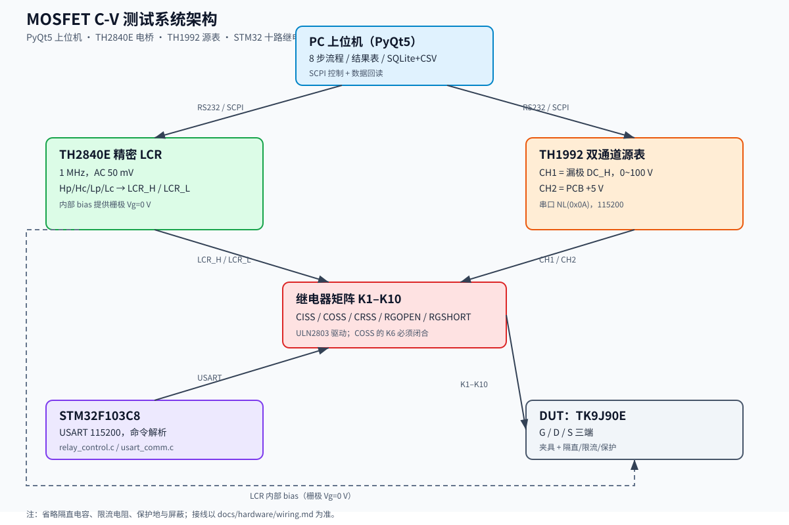
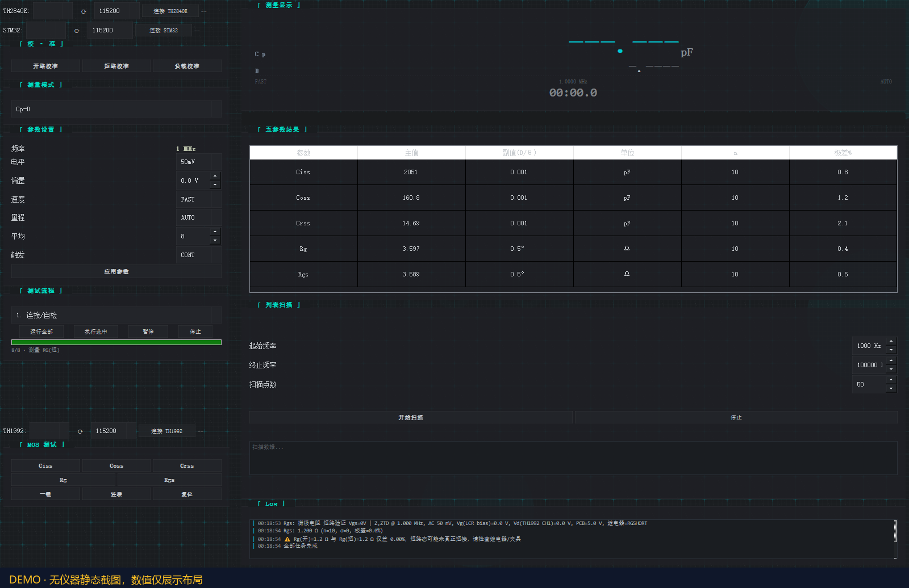
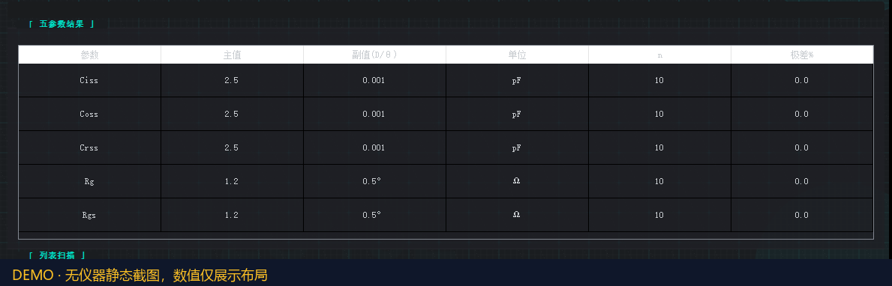

# 项目导览：MOSFET C-V 测试系统

> 第十届中国大学生集成电路创新创业大赛（CICC）· 同惠企业命题  
> 基于 TH1992 双通道源表 + TH2840E 精密 LCR 电桥，搭建 MOSFET 器件 C-V 测试系统。

## 30 秒了解

- **目标**：测 TK9J90E 等 MOSFET 的 Ciss / Coss / Crss / Rg，并给出可追溯的测量条件与原始点。
- **方案**：PyQt5 上位机通过 SCPI 控制 TH2840E 与 TH1992；STM32F103C8 控制 10 路继电器矩阵；结果写 SQLite/CSV。
- **关键设计**：8 步任务流程、显式状态机、单步执行、进度、暂停/停止、安全断电。
- **验证**：38 项 pytest；`doctor.py` 无仪器自检；假设备完整 8 步流程。
- **边界**：Vds 阶梯扫描/CV 曲线已取消；本系统只做固定偏置点五参数测量。

## 系统架构



- TH1992 **CH1 = 漏极 DC_H**（0~100 V）；**CH2 = PCB +5 V**，给继电器板供电；
- 栅极由 **LCR 内部 DC bias** 提供，当前 Vg=0 V；
- TH2840E 的 Hp/Hc/Lp/Lc 合并为 `LCR_H` / `LCR_L` 两线，经继电器矩阵切到 DUT；
- STM32 通过 USART 115200 控制 K1–K10，继电器矩阵完成五种测量拓扑切换。

> 具体接线与安全注意事项见 [`docs/hardware/wiring.md`](docs/hardware/wiring.md)。

## 界面截图

主界面：左侧连接/参数/8 步流程，右侧五参数结果表与日志。



五参数结果表（主值、副值 D/θ、单位、n、极差）：



> 截图为无仪器条件下的界面演示，数值用于展示布局，不是最终实测数据。

## 三个难点

### 1. 8 步流程不是“一个运行按钮”

把自检、开路、短路、五个测量拆成可单步、可暂停、可停止的任务：

- `core/tasks.py`：任务表 + `TaskProgress` 状态机；
- 单步执行也走同一套预检门禁；
- 暂停只在采样间生效，保持偏置/继电器；
- 停止/异常/关窗回安全态：关漏极、继电器开路。

### 2. TH2840E 命令必须按手册写

不是“发个 `FUNC:IMP CPD` 就行”。实现中按 V1.3.1 手册改成：

```text
FUNC:IMP CP,D
FUNC:IMP Z,ZTD
APER MED,n
FUNC:IMP:RANG <float>
LIST:MODE SEQ
```

并用 `tests/test_scpi.py` / `tests/test_th2840.py` 固定命令序列，防止回归。

### 3. Rg 只有几欧姆，两线制误差很大

- LCR 两线制丢失开尔文四线，pF 级靠开路/短路补偿；
- Rg（~3.5 Ω）需要短路扣除或四线改造；
- 代码增加 Rg(开)/Rg(短) 一致性告警：差异 <2% 时提示“短路态可能未真正短接”。

## 测量结果（历史数据）

| 参数 | 平均值 | 手册典型值 |
|---|---|---|
| Ciss | 2.051118 nF | 2 nF |
| Coss | 160.7996 pF | 150 pF |
| Crss | 14.69448 pF | 15 pF |
| Rg(开) | 3.597048 Ω | 3.5 Ω |
| Rg(短) | 3.588908 Ω | 3.5 Ω |

> 数据来自早期技术文档表 5.1；当时栅极条件与当前系统不同，**仅用于验证测量链路**，当前硬件需重新测量。Rg 开/短几乎相同是待核对项，不是已确认结论。

## 代码导览

| 先看 | 内容 |
|---|---|
| [`core/tasks.py`](core/tasks.py) | 8 步任务 + 状态机 |
| [`device/th1992.py`](device/th1992.py) | CH1 漏极 / CH2 PCB，电源顺序与范围校验 |
| [`device/th2840.py`](device/th2840.py) | TH2840E SCPI、主/副参数、校准 |
| [`ui/mainwindow.py`](ui/mainwindow.py) | 流程编排、进度/暂停/停止、结果表 |
| [`core/measurement.py`](core/measurement.py) | 条件、统计、重复性告警、CSV |
| [`core/storage.py`](core/storage.py) | SQLite 记录与旧库迁移 |
| [`tests/`](tests/) | 38 项无硬件测试 |

## 运行

```powershell
python -m venv .venv
.\.venv\Scripts\Activate.ps1
pip install -r requirements.txt
python main.py
```

无仪器自检：

```powershell
python doctor.py
```

测试：

```powershell
pytest
```

## 已知限制

1. TH1992 回显握手未实现（手册要求逐字符等待回显）；
2. 主线程 I/O 未改为 worker，长流程靠 `processEvents` 维持响应；
3. 无硬件 deadman：GUI 卡死/上位机崩溃时软件看门狗无法执行断电，TH1992 输出可能保持；
4. Rg 短路扣除/四线改造未实现；
5. 负载校准不可用（TH2840 手册未定义 `CORR:LOAD` 执行命令，按钮已禁用、方法抛 `NotImplementedError`）；
6. CH2/栅极实际接线需上电前核对；
7. D/θ 已落库，但旧数据没有副参数。

## 怎么验证

- 测试原始输出：[`docs/evidence/pytest.txt`](docs/evidence/pytest.txt)（`38 passed`）
- 测试清单：[`docs/evidence/test-inventory.md`](docs/evidence/test-inventory.md)
- 本地 `pytest`：**38 passed**（当前工作树；未公开仓库不引用 CI URL）
- commit/tag：[`docs/evidence/git-info.txt`](docs/evidence/git-info.txt)（`v1.4.2`，干净历史）
- 环境：[`docs/evidence/environment.txt`](docs/evidence/environment.txt)
- 哈希：[`docs/evidence/sha256sums.txt`](docs/evidence/sha256sums.txt)

复现：

```powershell
python -m pytest -q
python doctor.py
```

## 说明

- 本仓库是竞赛作品，代码与文档供学习/参考；
- TH2840E、TH1992 的完整厂家手册不在仓库，仅保留自己写的控制逻辑/接线文档；
- 技术文档中的队伍编号仅用于比赛归档；公开版本已清理文档元数据中的个人标识；
- 详细任务表见 [`docs/test_workflow.md`](docs/test_workflow.md)，赛题映射见 [`docs/requirements_traceability.md`](docs/requirements_traceability.md)。
